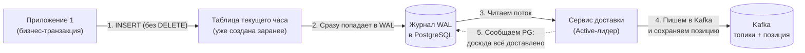
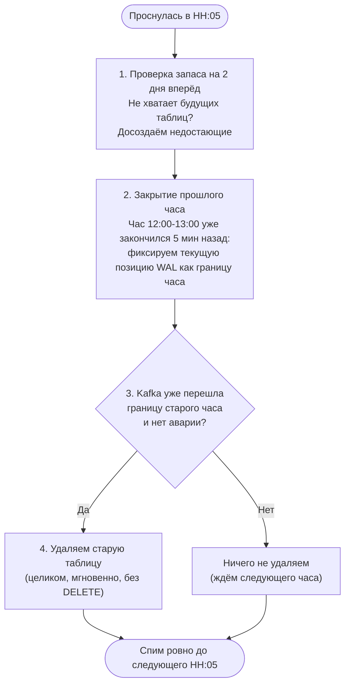
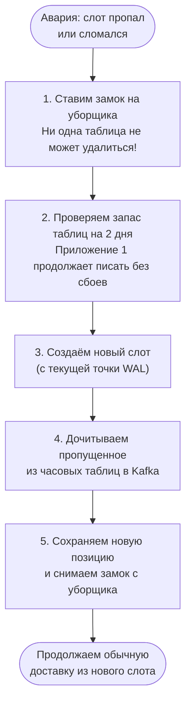
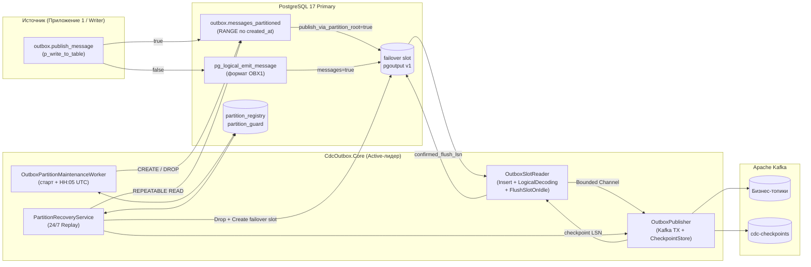
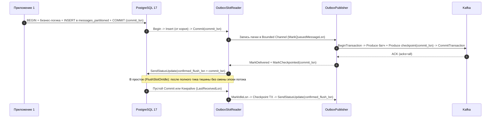
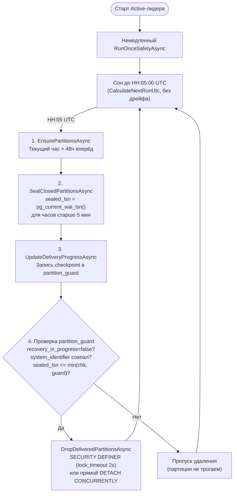
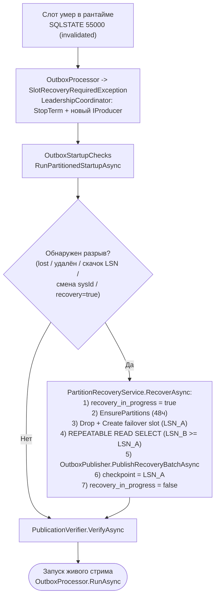

# Режимы `PartitionedTable` и `WalMessages`: как это работает

Документ разделён на две части:
1. **Простое объяснение (без кода и SQL)** — 3 лёгкие схемы, чтобы за минуту понять всю идею целиком.
2. **Техническая часть (под капотом)** — точные компоненты C#, таблицы PostgreSQL, защитные проверки, быстрое переключение и метрики.

---

# Часть 1. Как это работает (простыми словами)

## 1.1. Как сообщение идёт в обычном режиме (`INSERT` в почасовую таблицу)

Главное отличие от классического варианта: Приложение 1 **только вставляет (`INSERT`)** и никогда не делает `DELETE` — поэтому на таблице нет мёртвых строк и нагрузки от `autovacuum`.



> [!TIP]
> Если переключить флаг `p_write_to_table = false`, шаг с таблицей пропускается и сообщение летит **напрямую в журнал WAL** (целевой режим `WalMessages`). Слот пересоздавать не нужно.

---

## 1.2. Что делает фоновая джоба раз в час (в `HH:05`)

Джоба работает **только на активном лидере**. Первый раз — сразу при старте, дальше — раз в час ровно в `HH:05` (например `13:05`, `14:05`, `15:05`).



**Как это выглядит по часам на примере таблицы `12:00–13:00`:**
- **За 48 часов до `12:00`** — таблица уже создана пустой про запас (если джоба вдруг сломается, есть 2 дня на реакцию).
- **`12:00–13:00`** — Приложение 1 спокойно делает в неё `INSERT`.
- **`13:05`** — джоба фиксирует границу WAL для часа `12:00–13:00` (5 минут запаса нужны, чтобы транзакции, начатые в `12:59`, успели закоммититься). При этом таблица `11:00–12:00` уже удаляется.
- **`14:05`** — джоба видит, что Kafka давно прошла границу `13:05`, и **удаляет таблицу `12:00–13:00`**. Если Kafka стояла 3 часа, таблица просто ждёт на диске; когда Kafka догонит — джоба снесёт все доставленные часы за один раз.

---

## 1.3. Что происходит, если слот WAL умер (авто-восстановление 24/7)

Если слот удалили, переполнился WAL или произошёл сбой кластера — **люди не нужны**, сервис чинит себя сам и ничего не теряет благодаря сохранённым часовым таблицам.



**Почему при этом ничего не теряется:**
1. Замок гарантирует, что уборщик не удалит старые таблицы, пока мы не вычитаем «дыру».
2. Сначала создаётся **новый слот** (точка `A`), и **сразу после** делается чтение из часовых таблиц (снимок `B >= A`). Всё, что было до `A`, попадает в снимок; всё, что после `A`, поймает новый слот.

---

# Часть 2. Техническая схема (под капотом)

Ниже — точная карта для разработчиков, ревью и эксплуатации: какие классы, таблицы БД, SQL-функции и проверки стоят за каждым шагом.

## 2.1. Компоненты и переключатель режимов



| Режим `CdcOutbox:Storage:Mode` | Publication | Хранение в БД | Фоновая джоба партиций | Авто-восстановление 24/7 |
|---|---|---|---|---|
| `Table` *(по умолчанию)* | `outbox_publication` | `outbox.messages` (`INSERT+DELETE`) | Выключена | Штатный ручной `RecoveryMode` |
| `WalMessages` | `outbox_wal_publication` (пустая) | Нет таблицы (только WAL `OBX1`) | Выключена | Штатный ручной `RecoveryMode` |
| `PartitionedTable` | `outbox_partitioned_publication` (`publish_via_partition_root=true`) | `outbox.messages_partitioned` (`INSERT`-only) | Включена автоматически на Active | Включено автоматически (`AutoRecoverFromPartitions=true`) |

---

## 2.2. Сквозная последовательность доставки и простоев (`OutboxSlotReader` → `OutboxPublisher`)



---

## 2.3. Внутренние шаги джобы `OutboxPartitionMaintenanceWorker`



| Шаг | Таблица / SQL-функция (`infrastructure/postgres/init/04-wal-and-partitions.sql`) | Защита / метрика |
|---|---|---|
| 1. Предсоздание 48ч | `outbox.ensure_partitions(...)` → `outbox.partition_registry` | `outbox_future_partitions_count` (WARN если `< 48`, алерт `< 24`), `outbox_partitions_created_total` |
| 2. Запечатывание | `outbox.seal_closed_partitions(...)` → `partition_registry.sealed_lsn` | `range_end_utc <= now() - SealGraceMinutes(5)` |
| 3. Защитный курсор | `outbox.update_partition_guard_progress(...)` → `outbox.partition_guard` | Монотонный рост только при `recovery_in_progress = false` и совпадении `system_identifier` |
| 4. Удаление | `outbox.drop_delivered_partitions(...)` (или прямой `DETACH CONCURRENTLY`) | `SET LOCAL lock_timeout = '2s'`, пропуск при `lock_not_available`, `outbox_partitions_dropped_total`; сбой джобы не роняет живую доставку |

---

## 2.4. Внутренний поток 24/7 авто-восстановления (`LeadershipCoordinator` + `PartitionRecoveryService`)



| Событие / деталь | Где реализовано |
|---|---|
| Обнаружение смерти слота в рантайме | `OutboxProcessor.HandleReadingFailure` → `SlotRecoveryRequiredException` |
| Безопасная смена эпохи продюсера (без гонки с `IProducer`) | `LeadershipCoordinator.SuperviseDeliveryAsync` (остановка срока → `Dispose` старого `IProducer` → `GrantAsync` со свежим `IProducer`) |
| Определение причины разрыва при старте | `OutboxStartupChecks.DetectPartitionRecoveryReasonAsync` |
| Пошаговый replay без потерь | `PartitionRecoveryService.RecoverAsync` (`RecoveryOverlapMinutes = 5`, `RecoveryBatchSize = 1000`, метрики `outbox_partition_auto_recoveries_total` и `outbox_partition_recovered_messages_total`) |

---

## 2.5. Быстрое переключение режимов на стенде

```bash
# 1. Штатный режим (по умолчанию — без изменений)
docker compose up -d

# 2. Страхующие почасовые партиции (INSERT-only, 48ч запас, очистка в HH:05, 24/7 авто-восстановление)
CDCOUTBOX__STORAGE__MODE=PartitionedTable \
CDCOUTBOX__STORAGE__TABLE=messages_partitioned \
CDCOUTBOX__STORAGE__ENABLEWALMESSAGES=true \
CDCOUTBOX__REPLICATION__PUBLICATIONNAME=outbox_partitioned_publication \
WRITER__DEFAULTS__WRITEMODE=InsertOnly \
WRITER__DEFAULTS__TABLENAME=outbox.messages_partitioned \
docker compose up -d

# 3. Целевой безтабличный WAL (pg_logical_emit_message, формат OBX1, пустая publication)
CDCOUTBOX__STORAGE__MODE=WalMessages \
CDCOUTBOX__REPLICATION__PUBLICATIONNAME=outbox_wal_publication \
WRITER__DEFAULTS__WRITEMODE=WalMessage \
docker compose up -d
```

Все параметры конфигурации описаны в [CONFIGURATION.md](CONFIGURATION.md), а метрики — в [METRICS.md](METRICS.md).
